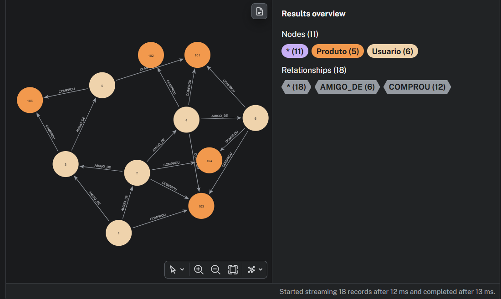
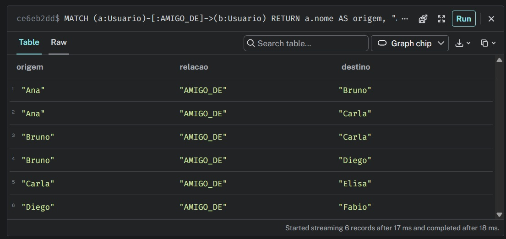
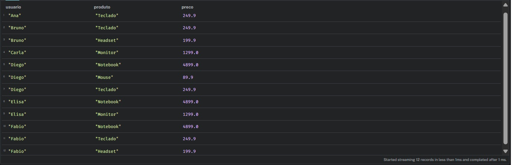
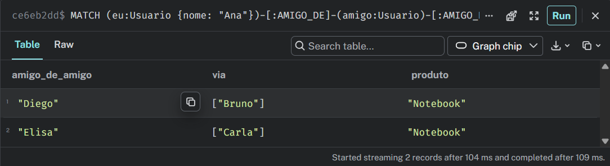
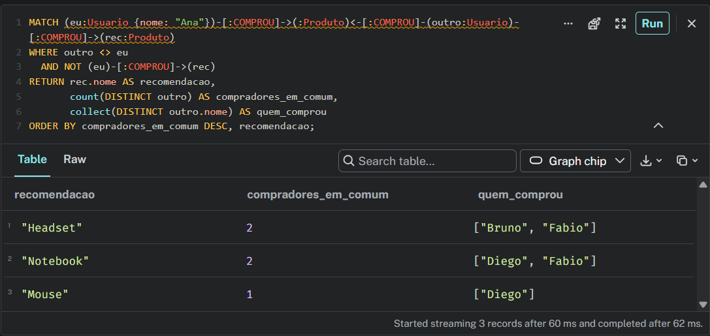

# Grafo de Recomendação e Cache de Carrinho (Neo4j + Redis)

Projeto de modelagem NoSQL especializada: um **grafo** (Neo4j/Cypher) para um sistema
de recomendação de e-commerce e o **key design** de um cache de carrinho de compras (Redis).

Aluno: Lucas Borges Krziminski

## Arquivos

| Arquivo | Conteúdo |
|---|---|
| `01_grafo_modelagem.cypher` | Parte 1: criação dos nós e relacionamentos do grafo |
| `02_grafo_consultas.cypher` | Parte 2: amigos de amigos que compraram o Produto X. Parte 3: recomendação por interesses em comum |
| `03_cache_carrinho.redis` | Partes 1, 2 e 3 (bônus) do cache: adicionar item, ler carrinho, TTL e invalidação no checkout |
| `img/` | Prints das execuções |

---

## Parte 1: Modelo de grafo

**Nós**
- `Usuario {id, nome}`
- `Produto {id, nome, preco}`

**Relacionamentos**
- `(Usuario)-[:AMIGO_DE]->(Usuario)`: uma seta por amizade; nas consultas usamos a seta sem direção (`-[:AMIGO_DE]-`) para enxergar a amizade dos dois lados.
- `(Usuario)-[:COMPROU]->(Produto)`

**Dados de exemplo:** 6 usuários, 5 produtos, 6 relações `AMIGO_DE` e 12 relações `COMPROU`.

| Usuários | | Produtos | |
|---|---|---|---|
| 1 | Ana | 101 | Notebook |
| 2 | Bruno | 102 | Mouse |
| 3 | Carla | 103 | Teclado |
| 4 | Diego | 104 | Headset |
| 5 | Elisa | 105 | Monitor |
| 6 | Fabio | | |



As bolinhas mostram o `id` (legenda na tabela acima). Contagens conferidas: Usuario (6),
Produto (5), AMIGO_DE (6) e COMPROU (12).




---

## Parte 2: Amigos de amigos que compraram o Produto X

Consulta para a usuária **Ana** e o produto **Notebook**:

```cypher
MATCH (eu:Usuario {nome: "Ana"})-[:AMIGO_DE]-(amigo:Usuario)-[:AMIGO_DE]-(fof:Usuario)-[:COMPROU]->(p:Produto {nome: "Notebook"})
WHERE fof <> eu
  AND NOT (eu)-[:AMIGO_DE]-(fof)
RETURN fof.nome AS amigo_de_amigo,
       collect(DISTINCT amigo.nome) AS via,
       p.nome AS produto
ORDER BY amigo_de_amigo;
```

- Dois saltos de `AMIGO_DE` formam o "amigo de amigo"; o `COMPROU` no final filtra quem comprou o produto.
- `fof <> eu` remove a própria usuária e `NOT (eu)-[:AMIGO_DE]-(fof)` remove os amigos diretos.

**Resultado:** Diego (via Bruno) e Elisa (via Carla). O Fabio também comprou o Notebook, mas está a
3 saltos da Ana, então não aparece.



---

## Parte 3: Recomendação por interesses em comum

"Quem comprou o mesmo produto que você também comprou...":

```cypher
MATCH (eu:Usuario {nome: "Ana"})-[:COMPROU]->(:Produto)<-[:COMPROU]-(outro:Usuario)-[:COMPROU]->(rec:Produto)
WHERE outro <> eu
  AND NOT (eu)-[:COMPROU]->(rec)
RETURN rec.nome AS recomendacao,
       count(DISTINCT outro) AS compradores_em_comum,
       collect(DISTINCT outro.nome) AS quem_comprou
ORDER BY compradores_em_comum DESC, recomendacao;
```

**Resultado para a Ana (comprou Teclado):**

| recomendacao | compradores_em_comum | quem_comprou |
|---|---|---|
| Headset | 2 | Bruno, Fabio |
| Notebook | 2 | Diego, Fabio |
| Mouse | 1 | Diego |



---

## Cache do carrinho (Redis)

### Key design

| Item | Definição |
|---|---|
| Chave | `cart:user:{id}` (ex: `cart:user:1`); para visitante sem login, `cart:session:{id}` |
| Estrutura | **Hash**: campo `produto:{id}`, valor = quantidade (número) |
| TTL | 86400 segundos (24 horas) |

Escolhemos Hash e não um JSON em String porque permite alterar a quantidade de **um item**
(`HINCRBY`) sem ler e reescrever o carrinho inteiro. Guardar a quantidade como número
(e não como texto) é o que permite o `HINCRBY`.

### Operações (arquivo `03_cache_carrinho.redis`)

| Comando | Para que serve | Saída esperada |
|---|---|---|
| `HSET cart:user:1 produto:103 1` | Adiciona o Teclado ao carrinho | `1` |
| `HSET cart:user:1 produto:102 2` | Adiciona 2 Mouses | `1` |
| `HINCRBY cart:user:1 produto:103 1` | Soma 1 à quantidade do Teclado | `2` |
| `HGETALL cart:user:1` | Lê o carrinho completo | `produto:103` = `2`, `produto:102` = `2` |
| `EXPIRE cart:user:1 86400` | Define o TTL de 24h (carrinho abandonado) | `1` |
| `TTL cart:user:1` | Mostra o tempo restante | `86400` |
| `DEL cart:user:1` | **Checkout:** invalida o carrinho | `1` |
| `EXISTS cart:user:1` | Confirma que a chave sumiu | `0` |
| `HGETALL cart:user:1` | Carrinho depois do checkout | vazio |

> Observação: as saídas acima foram conferidas executando os comandos em um Redis 7.0
> local (`redis-cli`).

### Estratégia de invalidação (bônus)

1. No **checkout**, o pedido é gravado primeiro no banco principal.
2. Só depois o carrinho é apagado do cache com `DEL cart:user:{id}`.
3. Se o usuário abandonar a compra, o **TTL de 24h** remove o carrinho automaticamente,
   sem precisar de nenhuma rotina de limpeza.

A ordem importa: se apagássemos o carrinho antes de gravar o pedido e algo falhasse, o
usuário perderia os itens sem ter concluído a compra.

---

## Como executar

Nunca coloque senhas ou strings de conexão neste repositório.

**Neo4j** (AuraDB Free, ou Neo4j local), na pasta do projeto:

```bash
cypher-shell -a "SUA_URI_NEO4J" -u neo4j -p "SUA_SENHA" -f 01_grafo_modelagem.cypher
cypher-shell -a "SUA_URI_NEO4J" -u neo4j -p "SUA_SENHA" -f 02_grafo_consultas.cypher
```

Também é possível colar os scripts no **Query** do Aura (uma instrução por vez).
O `01_grafo_modelagem.cypher` apaga o grafo antes de recriá-lo, então pode ser executado várias vezes.

**Redis** (local ou Redis Cloud):

```bash
redis-cli < 03_cache_carrinho.redis
# ou, com banco remoto:
redis-cli -h SEU_HOST -p SUA_PORTA --user default --pass "SUA_SENHA" < 03_cache_carrinho.redis
```

---

## Parte 4: Reflexão

**Por que um banco de grafos (Neo4j) é mais eficiente que um banco relacional (SQL) com JOINs
para o problema de "amigos de amigos"? E por que usar um cache em memória (Redis) para o
carrinho em vez de salvar direto no banco principal?**

**Grafo vs SQL.** No banco relacional, os relacionamentos não ficam guardados: eles são
**recalculados** a cada consulta, com JOINs. Para achar amigos de amigos, a tabela de amizades
precisa ser ligada a ela mesma, e cada salto a mais é um JOIN a mais. O custo cresce com o
tamanho das tabelas e com o número de saltos, e as consultas ficam longas e lentas à medida
que a rede cresce.

No grafo, a relação é um dado de primeira classe: cada nó guarda a ligação direta com seus
vizinhos. Para achar amigos de amigos, o banco apenas **caminha pelas conexões** a partir do
usuário, sem procurar em tabelas inteiras. O custo depende só da parte do grafo que a
consulta realmente percorre, e não do total de dados. Além disso, a consulta em Cypher
(`-[:AMIGO_DE]-()-[:AMIGO_DE]-`) descreve o caminho de forma direta, e adicionar mais um
salto é só acrescentar mais um trecho.

**Redis vs banco principal para o carrinho.** O carrinho é um dado **temporário**, lido e
alterado o tempo todo (cada item adicionado ou removido). O Redis guarda tudo em **memória**,
então leitura e escrita levam microssegundos, o que melhora a experiência do usuário. Além
disso, ele alivia o banco principal, que fica reservado para dados que realmente precisam de
persistência, como os pedidos finalizados. O Redis também traz o **TTL** de forma nativa: um
carrinho abandonado expira sozinho, sem rotina de limpeza. O cuidado é que a memória é
volátil, por isso o pedido é gravado no banco principal no checkout, antes de apagar o
carrinho do cache.

